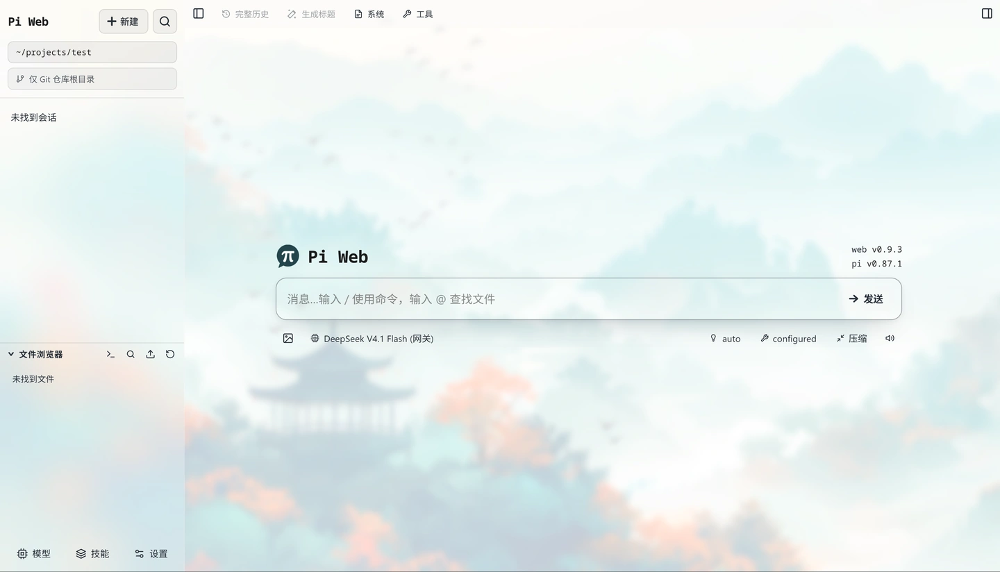
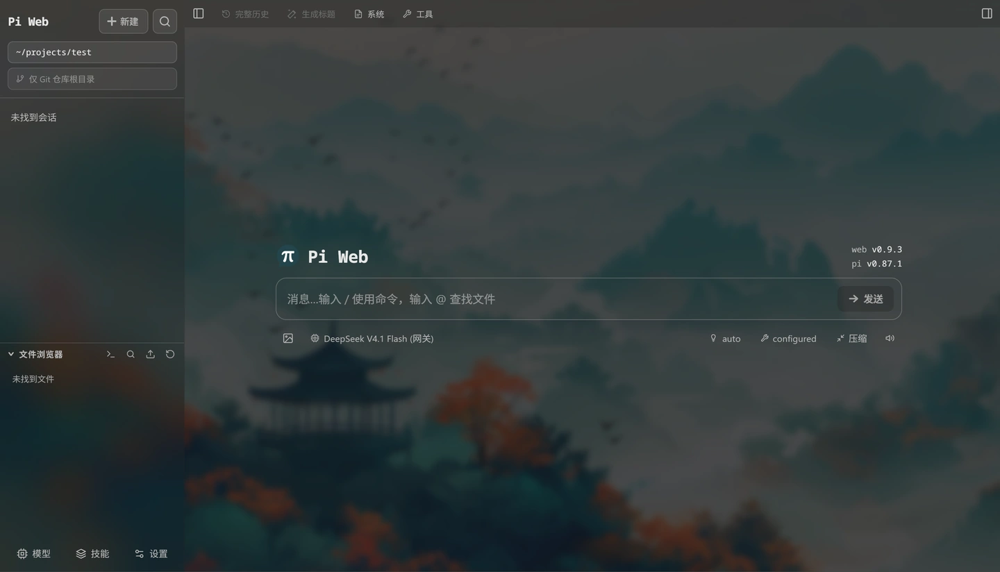

# pi-web-stylus-glassTheme

**pi-web 磨砂玻璃(毛玻璃)主题** · 基于谷歌浏览器 [Stylus](https://add0n.com/stylus.html) 扩展

> 为 [`@agegr/pi-web`](https://www.npmjs.com/package/@agegr/pi-web) 的界面换上一套**磨砂玻璃(毛玻璃)+ 壁纸背景**的外观。
> 全程**无侵入**:只覆盖 pi-web 的公开 CSS 变量与选择器,不改动安装目录里的任何文件,
> 因此 `npm i -g @agegr/pi-web` 升级后样式依然有效。

<p align="center">
  
  
</p>

<p align="center"><sub>左:浅色系(light) · 右:深色系(dark),均为真实 pi-web 界面截图</sub></p>

- **适配版本**:pi-web **v0.9.3**(`web v0.9.3 / pi v0.87.1`)
- **主题风格**:磨砂玻璃(macOS vibrancy 质感)
- **注入方式**:浏览器 Stylus 扩展 —— 不修改 pi-web 源码、不需要重新构建前端

---

## 目录

- [特性](#特性)
- [环境要求](#环境要求)
- [快速开始](#快速开始)
- [自定义与重新构建](#自定义与重新构建)
- [参数速查](#参数速查)
- [项目结构](#项目结构)
- [工作原理](#工作原理)
- [修订号与自检](#修订号与自检)
- [常见问题](#常见问题)
- [许可](#许可)

## 特性

- **一张壁纸铺满整个窗口**,侧栏 / 顶栏 / 聊天区 / 输入框 / 弹窗统一变成半透明磨砂玻璃。
- **同时适配 5 套内置主题**:浅色系 `light` / `mist` / `rose`,深色系 `dark` / `pine`,每套都单独调过底色与文字对比度。
- **无侵入、可升级**:只改 CSS 变量(`--bg`、`--bg-panel`、`--assistant-bg`、`--tool-bg`、`--user-bg` …),升级 pi-web 不会把样式覆盖掉。
- **细节对齐**:右侧 36px minimap 轨道与左栏同质感、输入框与消息列逐像素对齐、模态窗与左栏同一块玻璃、去掉面板之间多余的 1px 分隔线、minimap 节点圆点化。
- **可读性优先**:浅色系下把次级灰字压深,避免玻璃背景上文字对比度不足;配套 `tools/contrast-check.mjs` 可量化核对 WCAG 对比度。
- **参数化生成**:`build.sh` 一行命令即可换壁纸、调玻璃浓度、调纱的强度,产物是单份可直接粘贴的 CSS。
- **版本可校验**:每份产物带唯一修订号 `--piw-rev`,在浏览器里一条命令就能确认"页面上生效的到底是哪一版"。

## 环境要求

| 项目 | 要求 |
| --- | --- |
| pi-web | v0.9.3(其它版本可能需要对选择器做微调) |
| 浏览器 | Chrome / Edge / 等支持 `backdrop-filter` 的现代浏览器 |
| 扩展 | [Stylus](https://add0n.com/stylus.html) |
| 重新构建(可选) | Bash + Node.js ≥ 18;图像处理依赖 [sharp](https://sharp.pixelplumbing.com/)(已装 `@agegr/pi-web` 时会自动复用其自带的 sharp) |

> 只想用现成效果的话,**不需要 Node 环境**,直接取 `output/pi-web-theme.css` 粘贴即可。

## 快速开始

### 1. 安装 Stylus 扩展

在 Chrome / Edge 应用商店搜索 **Stylus** 并安装。

### 2. 新建样式并粘贴 CSS

1. 打开 `output/pi-web-theme.css`(仓库内已生成好,壁纸为 `assets/source/1.jpg`)。
2. Stylus → **管理** → **新建样式**,把整份 CSS 粘贴进去。
3. 点击 **Applies to** 的 `+`,按 pi-web 的访问地址添加匹配规则(前缀模式别填正则):

   | 模式 | 值 |
   | --- | --- |
   | URL 前缀 | `http://127.0.0.1:30141/` |
   | URL 前缀 | `http://localhost:30141/` |
   | 正则表达式 | `^https?://(127\.0\.0\.1\|localhost):30141/` |

   > `^ $ \ . |` 是正则语法,只对「正则表达式」模式有效;填进「URL 前缀」框里永远不会匹配。
   >
   > 不建议用「所有页面」:壁纸层和滚动条规则是无条件的,会在你访问的每个网站上都生效。

4. 保存 → 刷新 pi-web(`Ctrl + R`)。

### 3. 确认生效

按 `F12` 打开控制台,运行:

```js
getComputedStyle(document.documentElement).getPropertyValue('--piw-rev')
```

打印出的修订号应与 `output/pi-web-theme.css` 头部「修订:」一致(形如 `"r32-xxxxxxxx"`,后 8 位是产物内容的哈希)。不一致说明贴的是旧内容或样式未匹配。

## 自定义与重新构建

改外观只需要改 `build.sh` 里的默认参数,或临时追加同名参数(以最后一次为准):

```bash
./build.sh                                  # 用默认外观生成 output/pi-web-theme.css
./build.sh --tint 0.30                      # 玻璃更透,壁纸更明显
./build.sh --scrim 0.30 --tint-panel 0.45   # 减少白纱 + 面板更实
./build.sh --base-mix 0.35                  # 让玻璃色相跟着壁纸走(默认 0 = 全中性)
./build.sh --base-color '#7f899c'           # 手动指定壁纸基调色,覆盖自动提取
WALLPAPER=/绝对/路径/我的壁纸.jpg ./build.sh  # 换壁纸(直接给原图,构建时自动压成 webp 并缓存到 .cache/)

./src/generate.sh -h                        # 查看生成器全部参数
```

**颜色体系分两类:**

- **面板面**(侧栏 / 顶栏 / 右侧 minimap 轨道 / 各弹窗,即 `--bg-panel`):保持**中性**,不受壁纸染色 —— 换哪张壁纸,边栏都是同一块中性磨砂,只靠 alpha + `backdrop-filter` 与聊天区区分。
- **内容面**(聊天区 / 工具块 / 气泡,即 `--bg` / `--tool-bg` / `--assistant-bg` / `--user-bg`):默认保持**中性**(`--base-mix 0`),颜色完全靠壁纸透过磨砂呈现;加 `--base-mix 0.35` 则从壁纸提取「基调色」按比例混入,玻璃色相随壁纸走。

> `--base-mix` 调大会更贴壁纸色,但二级文字对比度会下降。改完用
> `BASE=<底色> node tools/contrast-check.mjs <tint> <scrim> <blur> <posX>` 核对 WCAG AA。

## 参数速查

| 参数 | 默认值 | 说明 |
| --- | --- | --- |
| `--preset <glass\|vivid\|crisp>` | `glass` | 预设:磨砂最重 / 壁纸色最足 / 壁纸细节最清晰 |
| `--scrim <0~1>` | `glass 0.45` | 白纱强度,越大壁纸越亮越"雾"(深色系自动换深纱) |
| `--tint <0~1>` | `0.56` | 内容面(`--bg`)不透明度,即"玻璃浓度",越小越透 |
| `--tint-panel <0~1>` | `tint × 0.65` | 顶栏 / 侧栏(`--bg-panel`)不透明度,顶栏文字看不清时调到 `0.85~0.95` |
| `--tint-tool <0~1>` | `tint × 1.05` | 工具条 / 输入框(`--tool-bg`)不透明度 |
| `--tint-bubble <0~1>` | `tint × 1.15` | 助手消息气泡(`--assistant-bg`)不透明度,想看更多壁纸调到 `0.30~0.45` |
| `--tint-user <0~1>` | `tint × 1.30` | 用户气泡(`--user-bg`)不透明度 |
| `--tint-popover <0~1>` | `0.6` | 普通浮层(下拉 / 弹窗)不透明度 |
| `--tint-minimap <0~1>` | `= tint-panel` | ChatMinimap 展开面板不透明度 |
| `--base-mix <0~1>` | `0` | 内容面混入壁纸基调色的比例,`0` = 全中性 |
| `--base-color <#rrggbb>` | 自动提取 | 手动指定基调色,覆盖自动提取结果 |
| `--blur <长度>` | `12px`(glass) | 壁纸层模糊半径,等同 CSS `blur()` 的高斯标准差 |
| `--saturate <倍数>` | `1.5` | 壁纸层饱和度 |
| `--backdrop <滤镜>` | `blur(18px) saturate(1.6)` | 面板毛玻璃滤镜,关闭可设 `none` |
| `--position <值>` | `72% center`(glass) | 壁纸对位,例如 `"45% center"` |
| `-o, --out <文件>` | 打印到 stdout | 产物输出路径 |

> 上表是 `src/generate.sh` 的预设默认值;`build.sh` 在其之上覆盖了一套已调好的默认参数
> (`--preset glass --scrim 0.52 --tint 0.33 --tint-panel 0.35 --tint-tool 0.50 --tint-bubble 0.35 --tint-user 0.55 --blur 4px --position "45% center"`),见 `build.sh` 顶部。

## 项目结构

```text
.
├── build.sh                          # 一键构建:壁纸 → 压缩 → 生成 CSS(output/pi-web-theme.css)
├── src/
│   └── generate.sh                   # 生成器本体(壁纸内联为 base64 + 全部 CSS 规则)
├── output/
│   └── pi-web-theme.css              # ★ 产物:粘进 Stylus 的就是这一份
├── assets/
│   ├── source/1.jpg                  # 默认壁纸原图
│   └── preview/                      # README 预览图(light / dark)
├── tools/
│   ├── verify.js                     # 浏览器自检片段(修订号 / 浮层层数 / 对齐 / 轨道)
│   ├── compress-wallpaper.mjs        # 原图 → 受控体积 webp(build.sh 自动调用,缓存到 .cache/)
│   ├── extract-color.mjs             # 从壁纸提取「基调色」
│   ├── contrast-check.mjs            # 量各层实际像素 + WCAG 对比度
│   ├── preview.mjs                   # sharp 合成的玻璃效果预览图(不依赖浏览器)
│   ├── preview-compare.mjs           # light / dark 对比预览图
│   ├── lib/sharp.mjs                 # 统一的 sharp 加载器
│   └── shots/                        # 预览图输出目录(生成物,不入库)
└── docs/                             # 本地设计笔记 / 排查记录(不随仓库发布)
```

## 工作原理

整套主题只做三件事,全部通过覆盖 pi-web 的公开 CSS 实现:

1. **壁纸层**:`html::before` 固定铺满视口,`z-index: -2` 压在界面之下,层内直接做 `filter: blur() saturate()` 并叠一层"纱"(scrim)控制可见度。
2. **玻璃面板**:把 pi-web 的面板 / 内容面 CSS 变量改写成 `rgba(..., alpha)`,再给最外层、自带底色的面板加 `backdrop-filter: blur() saturate()` —— 磨砂感来自"模糊 + 半透明",而不是给壁纸整体加权。
   - 只在**最外层、自己带底色**的块上加模糊;已经处在磨砂面板内部的子元素不再叠加,避免 `backdrop-filter` 形成 backdrop root 后把模糊吃掉。
3. **细节修正**:顶栏层级、输入框与消息列对齐、右侧轨道同质感、去除多余分隔线等。

因为改的全是 CSS,既不需要动 `node_modules/@agegr/pi-web`,也不涉及任何 JS 注入。

## 修订号与自检

- `src/generate.sh` 顶部 `PROJECT_REV="N"`,**改 CSS 规则时 +1**;
- 生成时自动拼上产物内容的 `sha256` 前 8 位 → 头部写 `修订:rN-xxxxxxxx`,文件末尾注入
  `:root{ --piw-rev: "rN-xxxxxxxx" }`;
- 于是"页面上生效的是哪一版"可以在浏览器里直接读出:

```js
getComputedStyle(document.documentElement).getPropertyValue('--piw-rev')
```

更完整的自检:把 `tools/verify.js` 整段粘进 pi-web 的 Console。它会打印修订号、
各浮层的层数与 `backdrop-filter`、层叠顺序、输入框与消息列是否对齐、底部层有没有压住右侧轨道等。
(注意:面板只有展开时才存在于 DOM 里,想检查哪个就先展开哪个。)

## 常见问题

**Q:粘贴后完全没变化?**
最常见原因是 Stylus 的 **Applies to** 没匹配。优先检查前缀地址(注意 pi-web 的端口,默认 `30141`),
以及是否用了「URL 前缀」模式却填了正则。用 `--piw-rev` 核对生效版本。

**Q:改完看着没生效?**
Stylus 是整份替换的 —— 每次都得**全选重新粘贴**,不能只改几行。再用 `--piw-rev` 确认。

**Q:升级 pi-web 后样式失效?**
pi-web 升级可能改动 DOM/类名。运行 `tools/verify.js` 定位失效的选择器,按提示调整
`src/generate.sh` 中的规则后重新构建。本主题基于 **v0.9.3** 的 DOM 实测编写。

**Q:玻璃上文字看不清?**
调大 `--tint`(内容面更实)与 `--scrim`(壁纸更亮);顶栏/工具条看不清就单独调大
`--tint-panel` / `--tint-tool`。改完用 `tools/contrast-check.mjs` 核对对比度。

**Q:想让玻璃色相跟着壁纸走?**
加 `--base-mix 0.35`(或更高),也可用 `--base-color '#rrggbb'` 手动指定基调色。

## 许可

本项目基于 [MIT License](LICENSE) 开源，Copyright (c) 2025 leexyy。

> 本项目为社区主题,与 pi-web 官方无隶属关系。壁纸素材版权归原作者所有,仅供演示;用于二次分发前请自行确认授权。
